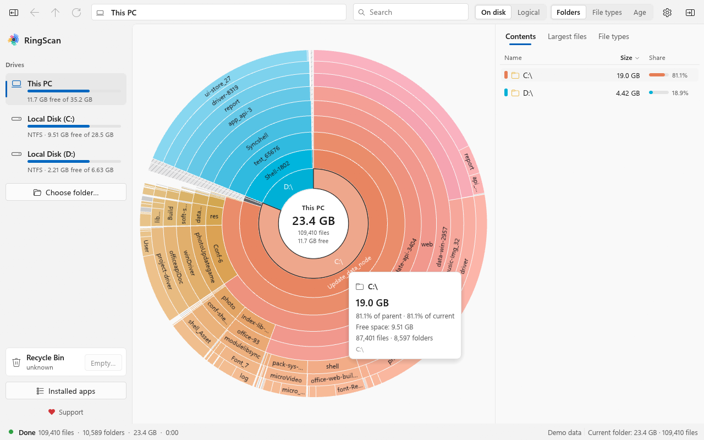
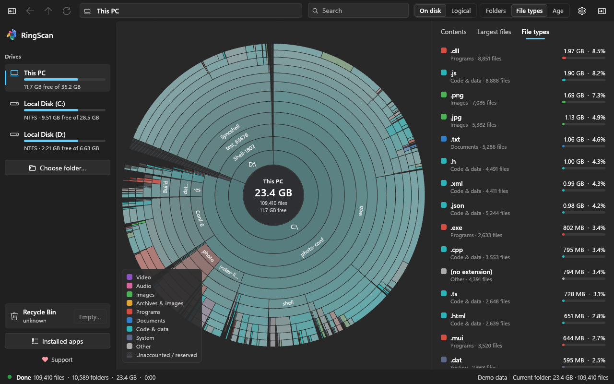

# RingScan

[](https://github.com/dimanester/ringscan/actions/workflows/ci.yml)
[](https://github.com/dimanester/ringscan/releases/latest)
[](https://github.com/dimanester/ringscan/releases)
[](LICENSE)

RingScan is a free, open-source disk space analyzer for Windows: it shows
where the space on your PC went. It scans all your
drives, one drive or a folder and draws the result as a sunburst chart:
the center is the folder you are looking at, each ring outward is one
folder level deeper, and each arc's angle is proportional to its size, so
the big folders stand out at a glance. Run as administrator, it reads a
whole NTFS drive in seconds. It is a single portable `.exe` with no
installer, and its interface is in English and Ukrainian. RingScan is a
modern remake of Steffen Gerlach's *Scanner* 2.13 (the classic freeware
disk usage visualizer), and an alternative to tools like WinDirStat,
WizTree, SpaceSniffer and TreeSize for people who prefer a sunburst chart.



*The screenshots show RingScan's built-in demo data, not a real disk.*

## Download

Get **`RingScan.exe`** from the
[latest release](https://github.com/dimanester/ringscan/releases/latest).
It runs on Windows 10 and 11 (x64). There is nothing to install: put the
exe anywhere and start it. Settings are kept in `%APPDATA%\RingScan`.

The exe is not code-signed, so the first time you start it Windows
SmartScreen may say **"Windows protected your PC"**. Click **More info**,
then **Run anyway**.

To check that your copy is the one GitHub Actions built from this
repository:

* compare its SHA-256 with the `RingScan.exe.sha256` file next to it in the
  release (PowerShell: `Get-FileHash .\RingScan.exe`), or
* verify its build provenance attestation with the
  [GitHub CLI](https://cli.github.com/):

  ```text
  gh attestation verify RingScan.exe -R dimanester/ringscan
  ```

## Features

* **Everything at once**: all fixed drives under "This PC", a drive, or any
  folder. Hover an arc for its size, share of the parent and of the
  current view, file and folder counts and date; click to zoom in
  (animated), click the center to go up. Tiny items are merged into
  "N smaller items".
* **Fast, with a live chart.** As administrator, NTFS drives are read from
  the master file table (MFT): about a million files in 4 to 5 seconds,
  including folders a normal scan is not allowed to open. Otherwise drives
  are walked folder by folder in parallel (8 threads per physical disk,
  disks at the same time). The chart grows while the scan runs.
* **Scans kept in memory**: switching between drives, "This PC" and
  folders shows the earlier scan instead of scanning again; F5 rescans.
* **Numbers that add up**: size on disk or logical size; hard links counted
  once; junctions and symbolic links listed but not followed; cloud
  placeholders (OneDrive and similar) counted by the space they use
  locally. Each drive also shows `<reserved by Windows>` (the storage
  reserve Windows keeps for updates, about 5 GB on a system drive, plus
  NTFS's own reservations) and `<unaccounted>` (used space the scan could
  not see, such as folders it was denied), so a drive adds up to what
  Windows reports. Both fill their wedge out to the edge of the chart,
  hatched, so they read as "not attributable" rather than as a gap. Free
  space is written in the center of the chart; a setting draws it as an
  arc instead.
* **Side panels**: drives with their free space, the Recycle Bin (size,
  "Empty…"), a shortcut to Settings › Installed apps; the current folder's
  contents (sortable), the largest files and a file-type breakdown.
* **Search** by name, with the matches highlighted in the chart.
* **Color modes**: by folder, by file type, by age. Light and dark themes
  follow Windows; per-monitor DPI; Windows 11 look.
* **Readable at any size**: the number of rings follows the window, so
  there is room for folder names in a small window and more levels in a
  big one (or set a fixed number in Settings).
* **Act on what you find**: Open, Show in Explorer, Copy path, Properties,
  Rescan, Move to Recycle Bin, Delete permanently. Totals and free space
  update right away.
* **Safe deletes**: every delete is confirmed, and "Move to Recycle Bin"
  never silently becomes a permanent delete. If the bin refuses an item
  (for example on a drive without one), RingScan tells you and asks
  separately. Names that end in a dot or a space are handled exactly, and
  an item that changed after you selected it is not deleted.
* **Explorer integration** (optional, per user, no administrator rights):
  "Open in RingScan" on folders, drives and folder backgrounds.
* **Command line** for scripts: `RingScan.exe --cli <PATH|X:|all> [--json]`.
* **Private**: RingScan makes no network requests. The "Support" dialog
  only opens links when you click them.



## Usage

```text
RingScan.exe                     scan all fixed drives ("This PC")
RingScan.exe D:\                 scan a drive (or any folder) and show it
RingScan.exe --cli <PATH|X:|all> [--json] [--method auto|mft|walk] [--depth N] [--top N]
                                 [--threads N] [--logical] [--all-links] [--max-children N]
                                 [--progress] [--dump FILE]
RingScan.exe --cli --help        command-line options
```

| Input | Action |
|---|---|
| click a folder arc · click the center | zoom in · up one level |
| right click | context menu (zoom, open, show in Explorer, copy path, rescan, recycle, delete, properties) |
| Backspace, Alt+←, mouse Back, middle click | back |
| Alt+↑ | up one level |
| F5 | rescan the current folder |
| Ctrl+F · Esc | search · clear search / selection |
| Delete · Shift+Delete | move the selected item to the Recycle Bin · delete permanently (both confirmed) |
| Ctrl+C | copy the path of the hovered or selected item |

Settings (gear icon): language, theme, free space on or off (off by
default: the chart, the "Share" column and the percentages then use the
used space, and the center of a drive or "This PC" says how much is free),
number of rings, smallest arc, the Explorer context-menu entry, "Restart
as administrator" and "Support RingScan".

### Administrator / MFT mode

Without administrator rights Windows usually refuses raw volume reads, so
drives are walked folder by folder (a 2 TB system drive with about a
million files takes 25–30 s) and folders you may not open end up in
`<unaccounted>`. Run RingScan as administrator (Settings › "Restart as
administrator", or right-click the exe › "Run as administrator") and NTFS
drives are read from the MFT instead: much faster, and `<unaccounted>`
shrinks to a few NTFS structures the reader does not count (about 0.2 GB
on a 2 TB system drive). The status bar shows the method used for each
drive; hover it to see why a drive was walked.

To compare both methods on `C:` from an **elevated PowerShell**:

```powershell
$rs = 'C:\Tools\RingScan.exe'   # wherever you put it
& $rs --cli C: --method mft  --depth 1 --top 20 --dump "$env:TEMP\c-mft.tsv"  | Out-String
& $rs --cli C: --method walk --depth 1 --top 20 --dump "$env:TEMP\c-walk.tsv" | Out-String
```

### Command line from a terminal

`RingScan.exe` is a GUI program that attaches to the calling console for
`--cli`. cmd.exe does not wait for GUI programs: use
`start /wait RingScan.exe --cli ...` to get the report before the prompt
returns, or redirect it to a file
(`RingScan.exe --cli C:\Windows > report.txt`). In PowerShell pipe it
(`| Out-String`, `| Out-File report.txt`) or use
`Start-Process -Wait -NoNewWindow`; PowerShell's own `> file` does not
capture GUI programs. Exit codes: 0 scanned, 1 nothing could be scanned,
2 usage error. `--json` prints one JSON object; `--dump FILE` also writes
every file as a tab-separated line.

## Support

If RingScan helped you, you can support my open-source work ☕ — by card, Apple Pay or
Google Pay from any country via a [Monobank jar](https://send.monobank.ua/jar/4w6egVrfe2),
or with crypto (USDT TRC-20, BTC): see [DONATE.md](https://github.com/dimanester/.github/blob/main/DONATE.md).
The same channels are in the app (♥ Support, at the bottom of the sidebar or in Settings);
it opens nothing by itself and makes no network requests.

Bug reports and ideas are welcome in
[Issues](https://github.com/dimanester/ringscan/issues).

## Build from source

RingScan is written in Rust and cross-compiled for Windows from Linux or
WSL with mingw-w64. `rust-toolchain.toml` pins the compiler; rustup
installs it on first use.

```bash
sudo apt install gcc-mingw-w64-x86-64                      # linker and windres
cargo build --release --locked --target x86_64-pc-windows-gnu -p ringscan
# -> target/x86_64-pc-windows-gnu/release/ringscan.exe (single portable exe, ~14 MB)
cargo build --release --locked --target x86_64-pc-windows-gnu -p ringscan-engine --bin ringscan-cli
```

`.cargo/config.toml` links statically with mingw-w64 (no extra DLLs) and
sets `scripts/winrun.sh` as the runner, so `cargo run` / `cargo test` with
`--target x86_64-pc-windows-gnu` execute on the Windows host when building
from WSL. `ringscan-cli.exe` (from `crates/engine`) is the same command
line as a console program.

Releases are built by [GitHub Actions](.github/workflows/release.yml) from
a version tag on a main commit that passed CI: the same build, a check that
the exe imports only system DLLs, a SHA-256 file and a build provenance
attestation. See
[CHANGELOG.md](CHANGELOG.md) for what changed.

## Development

### Test

```bash
cargo test -p ringscan-core -p ringscan-ntfs -p ringscan-win -p ringscan-engine -p ringscan   # Linux
cargo test --target x86_64-pc-windows-gnu -p ringscan-win          # Windows host (see crates/win/README.md)
cargo test --target x86_64-pc-windows-gnu -p ringscan-engine       # Windows host
cargo test --target x86_64-pc-windows-gnu -p ringscan              # Windows host
sudo scripts/make-ntfs-fixtures.sh                                  # NTFS images for the MFT tests
```

Without the NTFS images the fixture-based tests skip themselves with a
notice. Build one crate at a time with `-p` (the GUI crate builds on Linux
only for its unit tests). CI runs rustfmt, clippy (Linux and the Windows
target) and the Linux tests, and builds the exe
([ci.yml](.github/workflows/ci.yml)).

The GUI has a scripted test harness (`--script` / `--script-file`, see
[crates/app/README.md](crates/app/README.md)) that injects input, takes
screenshots and dumps the state as JSON; scripted runs never touch the
user's settings, clipboard or Explorer menu entry, and never show a UAC
prompt. Destructive tests only ever touch files they created under
`%TEMP%\ringscan-dev`. `--demo` replaces the scan with a synthetic "This
PC" (no disk access), which is what the screenshots above show.

### Layout

| Crate | What |
|---|---|
| `crates/core` (`ringscan-core`) | platform-independent: arena tree, parallel walker, sunburst layout, stats, formatting |
| `crates/ntfs` (`ringscan-ntfs`) | MFT reader over a `ReadAt` trait, tested on mkntfs images |
| `crates/win` (`ringscan-win`) | Windows primitives: directory listing with allocated sizes, raw volume reads, drives, shell actions, Recycle Bin, registry verb |
| `crates/engine` (`ringscan-engine`) | scan jobs (MFT or walk per drive, hard links once, free/unaccounted space, rescan, delete) and the CLI |
| `crates/app` (`ringscan`) | the GUI exe (eframe/egui on Direct3D 12) |

[SPEC.md](SPEC.md) is the original design document and the cross-crate
contracts; each crate's README has its design notes and measurements.

## License

[MIT](LICENSE) © 2026 Dmytro Nesterenko
